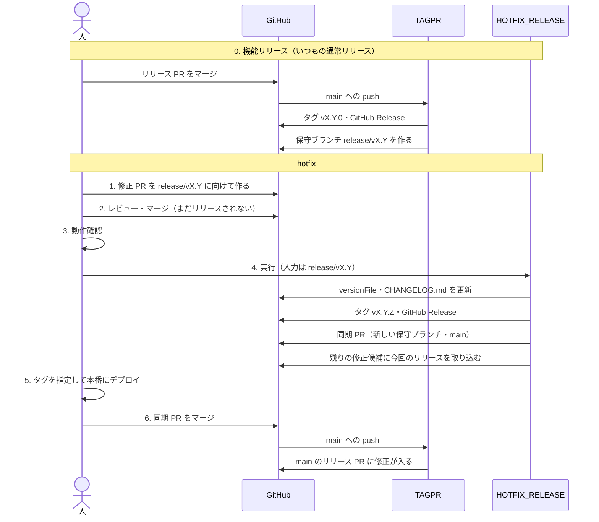
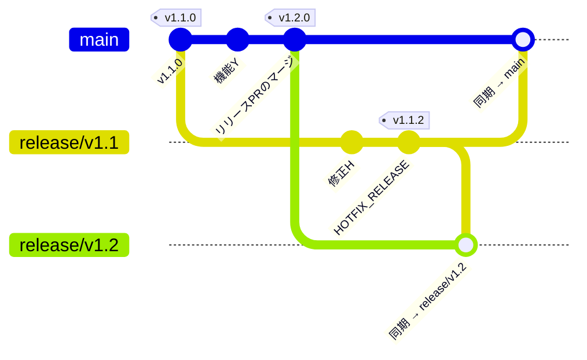

# hotfix の流れ

hotfix が起きたときに、いつ・どこで・何が起きるかの流れです。人がやるのは、PR を作ってマージすることと、ワークフローを実行することの2種類です。

## それぞれの手順

1. 修正 PR を作る: 本番で動いている系統の保守ブランチに向けて作る

2. レビュー・マージ: 出したい候補を保守ブランチにマージする。この時点ではまだリリースされない

3. 動作確認: 保守ブランチの内容で動作を確認する（検証環境の用意は、この検証の対象外）

4. HOTFIX_RELEASE を実行: Actions のページから、保守ブランチ名を入力して実行する。タグ・GitHub Release・同期 PR ができる

5. 本番にデプロイ: 今までどおり、タグを指定してデプロイする

6. 同期 PR をマージ: main のリリース PR に修正が入る。デプロイの前でも後でも構わない

手作業でやっていた versionFile と CHANGELOG.md の更新、リリース PR の Close は、すべてワークフローが行います。

## 同期 PR をマージするまでの main

同期 PR をマージするまでの間、main では次のようになります。

- TAGPR のガードが「最新タグが main に未反映」と判断し、リリース PR を更新しない（警告が出るだけで、ジョブは成功する）
- HOTFIX_RELEASE が、古くなった main のリリース PR を Close している。同期 PR をマージすると、TAGPR がリリース PR を作り直す

機能リリースを急ぐときは、先に同期 PR をマージしてください。

## 機能リリースのタグから本番デプロイまでの間の hotfix

この期間は、本番でまだ1つ前の系統が動いています。hotfix は1つ前の保守ブランチ（例: `release/v1.1`）から出します。

HOTFIX_RELEASE は、自分より新しい保守ブランチにも同期 PR を作ります。`release/v1.1` で v1.1.2 を出すと、`release/v1.2` と main の両方に同期 PR ができます。新しい系統を本番に出したときに、修正が消えないようにするためです。

