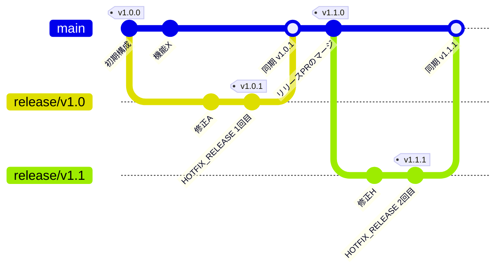

# 運用ルール

仕組みより先に、運用のルールを決めました。ワークフローは、このルールを人の代わりに守るためのものです。

## ブランチ

- `release/vX.Y` を、その系統の hotfix 用の保守ブランチにする（名前を `vX.Y` にした理由は [ブランチ名と番号の関係](#branch-name-and-version)）
- 機能リリースのタグ（例: v1.1.0）が付いたら、そのタグから `release/v1.1` を自動で作る
- main には未リリースの機能が入っているので、hotfix には使わない。hotfix は必ず保守ブランチから出す
- 1つ前の系統の保守ブランチは、次の系統を本番に出したら消してよい（タグは残る）。検証リポジトリでは、動きを追えるように全部残しています

## 番号の付け方

- 機能リリースは minor を上げる（v1.1.0、v1.2.0、…）
- hotfix は patch を上げる（v1.1.1、v1.1.2、…）

番号の帯を分けておくと、機能リリースと hotfix で番号がぶつかりません。hotfix をいくつ出しても、次の機能リリースは v1.2.0 のままです。リリースノートを見る側も、どれが機能リリースでどれが hotfix かを番号で見分けられます。

## ブランチ名と番号の関係 {#branch-name-and-version}

保守ブランチの名前 `release/vX.Y` は、上の番号の付け方とセットで決めています。

- 機能リリースで minor を上げるので、1つの系統は、機能リリース（vX.Y.0）から始まる `vX.Y.*` の並びになる。そのため、系統は `vX.Y` で表せる
- HOTFIX_RELEASE は、ブランチ名の `vX.Y` から、`vX.Y.*` の最新タグの patch を上げて次の番号を決める。ほかの系統の hotfix と番号がぶつからない
- 機能リリースのタグ vX.Y.0 から `release/vX.Y` を作るので、タグの番号を見れば、どの保守ブランチの系統かが分かる

::: details 機能リリースでも patch だけを上げる場合
機能リリースも hotfix も patch だけを上げる（v1.0.x を続ける）と、全部が v1.0 系統になり、`release/v1.0` では系統を分けられません。

その場合は、系統を始めた機能リリースのタグで名前を付け（例: `release/v1.0.5`）、hotfix の番号は tagpr と同じく全ブランチの最新タグに patch を足して決める形になります。ただし、機能リリースのタグを作ってから本番に出すまでの間に1つ前の系統へ hotfix を出すと、古い系統の番号のほうが大きくなります（例: 新しい系統 v1.0.8 のあとに、古い系統の hotfix が v1.0.9）。

この形は検証していません。
:::

## 修正の向き先

修正 PR は、本番で動いている系統の保守ブランチに向けます。本番が v1.1.x なら `release/v1.1` です。

機能リリースのタグを作ってから本番にデプロイするまでの間は、間違えやすいので注意が要ります。タグは v1.2.0 でも、本番ではまだ v1.1.x が動いています。この間の hotfix は、1つ前の `release/v1.1` に向けます。

::: warning 修正候補の付け替え
検証リポジトリでは、機能リリースのタグを作った時点で、開いている修正候補を新しい保守ブランチに自動で付け替えています。上の期間に本番向けの hotfix を出すときは、向き先を1つ前の保守ブランチに戻してください。付け替えるタイミングは [残った課題](./open-issues) にも書いています。
:::

## 同期の向き

hotfix の修正は、古い系統から新しい系統へ、前に向かって流します。`release/v1.1` で出した修正は、`release/v1.2`（あれば）と main に同期 PR で取り込みます。

こうしておかないと、新しい系統を本番に出したときに修正が消えます。同期 PR は自動で作り、versionFile と CHANGELOG.md だけのコンフリクトも自動で解消します。中身のコンフリクトは、今までどおり人が解消します。

## 機能リリースとの順番

main への同期 PR をマージするまでは、main のリリース PR を更新しません。tagpr を動かす前のガードで止めています。

番号のずれを防ぐためです。あわせて、main の versionFile が最新のタグより古いままになっていたら、エラーで止めます。以前の事故と同じ状態になったら、すぐ気づけます。

## 候補が複数のとき

- hotfix の候補ごとに PR を作る。リリースの時期は分けて構わない
- 出したい候補を保守ブランチにマージしてから、HOTFIX_RELEASE を実行する
- 番号は出した順に振られる。残りの候補には、今回のリリースが自動で取り込まれる

人が決めるのは「どれから出すか」だけです。
